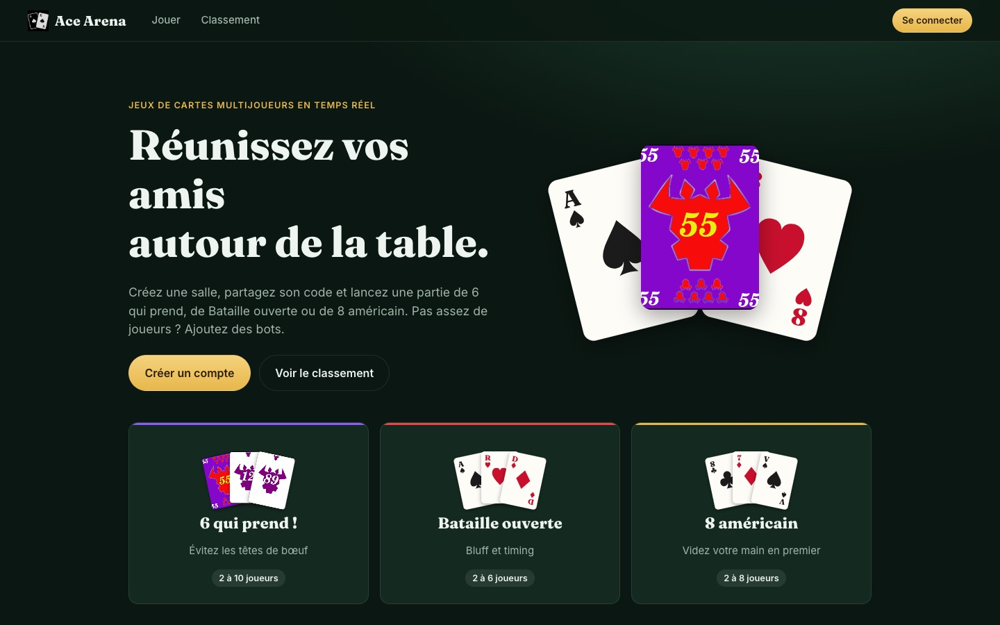
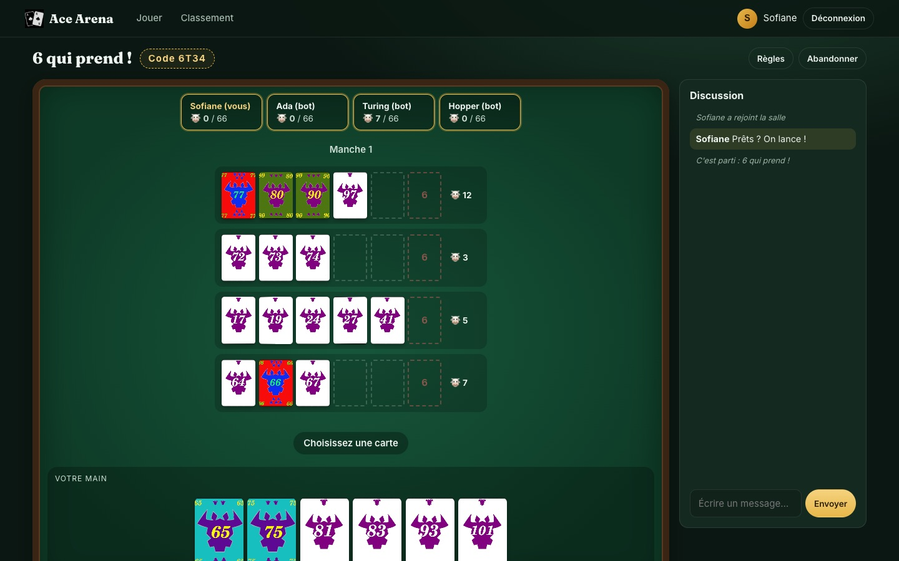
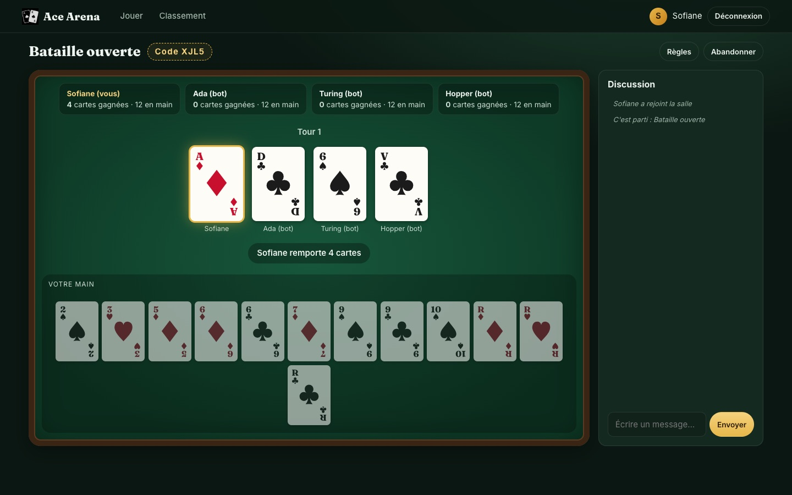
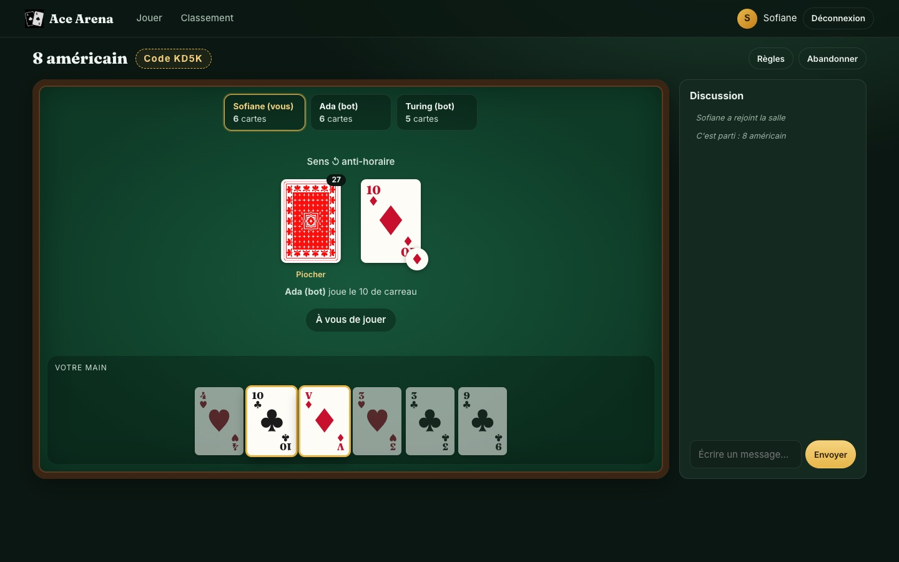
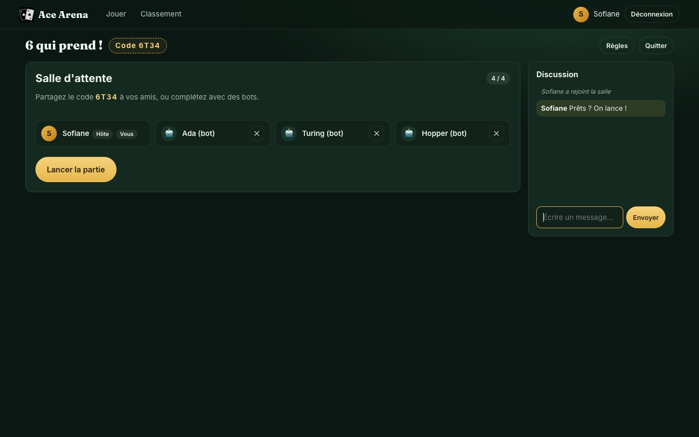
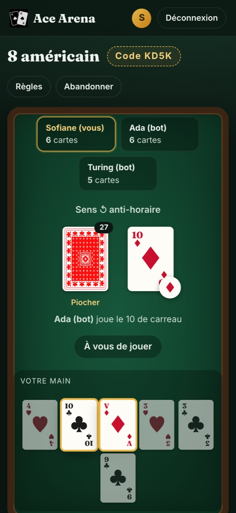

# Ace Arena — jeux de cartes multijoueurs en temps réel


Plateforme web où plusieurs joueurs se retrouvent autour d'une table virtuelle pour jouer à **6 qui prend !**,
à la **Bataille ouverte** ou au **8 américain**. On crée une salle, on partage son code de 4 lettres, et on
complète la table avec des bots si besoin.



## Aperçu

### 6 qui prend !
Les cartes choisies sont posées de la plus petite à la plus grande ; la 6e carte d'une rangée fait ramasser
ses têtes de bœuf. Le compteur de chaque joueur est affiché en haut de la table.



### Bataille ouverte
Tout le monde choisit une carte face cachée, puis elles sont révélées ensemble : la plus forte remporte le pot.



### 8 américain
Les cartes jouables sont mises en évidence ; la pastille sur la défausse indique la couleur demandée
(modifiable avec un 8).



### Salle d'attente et version mobile

| Salle d'attente : code à partager, bots, chat | Mobile |
| --- | --- |
|  |  |

## Fonctionnalités

- **3 jeux complets** avec leurs règles : 6 qui prend (manches jusqu'à 66 têtes), Bataille ouverte (choix simultané, bataille en cas d'égalité), 8 américain (8 joker, as +2 cumulable, 7 qui fait passer, valet qui inverse le sens)
- **Salles privées** avec un code à partager, et liste des salles ouvertes mise à jour en direct
- **Bots** pour compléter la table ; ils prennent aussi le relais d'un joueur qui abandonne ou se déconnecte
- **Reconnexion** : recharger la page ou perdre le réseau ne fait pas perdre sa place dans la partie
- **Chat** dans chaque salle, avec les événements de la partie
- **Comptes et classement** (victoires et taux de victoire par jeu)
- **Interface responsive**, jouable sur mobile

## Architecture

```
client/  (React + Vite)                          server/  (Node.js)
┌──────────────────────────┐   WebSocket   ┌─────────────────────────────────┐
│ Pages : accueil, salon,  │ ◄───────────► │ Socket.IO ── RoomManager        │
│ salle, classement        │  intentions   │               │ salles, bots,   │
│                          │  ("je joue    │               │ reconnexion     │
│ Tables de jeu : affichent│   tel coup")  │               ▼                 │
│ la vue reçue du serveur  │               │ Moteurs de jeu (fonctions pures)│
│                          │  vue filtrée  │  bataille · 6 qui prend · 8 am. │
│                          │ ◄──────────── │                                 │
│                          │   REST        │ Express : /api/register, login, │
│ Session (token)          │ ◄───────────► │ leaderboard ── SQLite           │
└──────────────────────────┘               └─────────────────────────────────┘
```

Le **serveur est l'arbitre** de la partie : il mélange et distribue les cartes, vérifie chaque coup et calcule
les scores. Le client n'envoie que des intentions (« je joue le 42 ») et reçoit une **vue filtrée** de la partie :
chaque joueur ne voit que sa propre main, ce qui empêche la triche.

Les trois jeux partagent la même interface (`create`, `act`, `view`, `canAct`, `advance`, `botAction`). Ajouter un
jeu revient à écrire un module dans `server/src/games/` et un composant de table dans `client/src/games/`.

```
server/src/
├── index.js          # Express + Socket.IO, authentification des sockets
├── rooms.js          # Salles, déroulement des parties, bots, reconnexion, chat
├── auth.js           # Comptes (scrypt + sel), sessions par jeton
├── db.js             # Schéma SQLite et classement
└── games/            # Règles des jeux, sans dépendance au réseau
client/src/
├── pages/            # Accueil, connexion, salon, salle, classement
├── games/            # Tables de jeu (une par jeu)
├── components/       # Cartes, chat, fenêtres
└── lib/              # Session + Socket.IO, métadonnées des jeux
```

## Lancer le projet

Prérequis : **Node.js 22.13 ou plus récent** (la base utilise le module natif `node:sqlite`, sans compilation).

```bash
git clone https://github.com/sofianeham34/Plateforme-de-jeux-de-cartes.git
cd Plateforme-de-jeux-de-cartes
npm install
npm run dev        # serveur sur :3001 + client sur http://localhost:5173
```

Production (un seul processus qui sert aussi le client) :

```bash
npm run build && npm start      # http://localhost:3001
# ou avec Docker
docker build -t ace-arena . && docker run -p 3001:3001 -v ace-data:/data ace-arena
```

Pour essayer seul : créez un compte, une salle, ajoutez des bots et lancez la partie.
Pour jouer à plusieurs en local, ouvrez un second navigateur (ou une fenêtre privée) avec un autre compte.

## Tests

```bash
npm test
```

21 tests (`node:test`) :
- **règles** de chaque jeu (têtes de bœuf, placement des rangées, as cumulés, 8 joker, 7, valet, bataille…) ;
- **simulation de 180 parties complètes** entre bots, pour vérifier qu'elles se terminent toujours ;
- **intégration** API + Socket.IO : inscription, refus d'une tentative d'injection SQL, socket non authentifié
  refusé, partie complète contre un bot, et vérification que la main d'un adversaire n'est jamais envoyée.

## Sécurité

- Mots de passe hachés avec **scrypt** et un sel par compte, comparaison en temps constant
- Requêtes SQL **préparées** uniquement
- Sockets authentifiés par jeton de session ; chaque action est vérifiée côté serveur (tour, carte en main, coup légal)
- Aucune information cachée (mains adverses, cartes non révélées) n'est envoyée au client

## Équipe

Projet réalisé en **L2 Informatique** à l'Université de Montpellier par Sami Chbicheb, Dogukan Tokmak,
Sofiane Hammar et Aly Hachem Reda. Les illustrations des cartes du 6 qui prend ont été dessinées par l'équipe.
